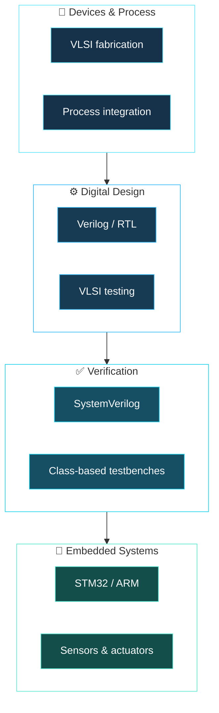

<!-- ═══════════════════════════  HEADER  ═══════════════════════════ -->

  

  

  
  
  

  
  
  

---

<!-- ═══════════════════════════  ABOUT  ═══════════════════════════ -->

<table>
<tr>
<td width="56%" valign="top">

### Engineering signature

GARV KISHORE GUPTA · VLSI / VERIFICATION / EMBEDDED

### From device physics to working hardware.

I am an Electronics and Communication Engineering undergraduate at **Manipal Institute of Technology**, specializing in **VLSI Design & Technology**. I enjoy moving between semiconductor process fundamentals, digital design verification, and embedded systems—and documenting the assumptions, evidence, and limitations at every layer.

**MIT Manipal** · B.Tech ECE 
VLSI Design & Technology

 

**01 &nbsp; UNDERSTAND** 
Start from the device, circuit, or protocol fundamentals.

**02 &nbsp; BUILD** 
Turn the model into RTL, firmware, or a process study.

**03 &nbsp; VERIFY** 
Test the behavior and state clearly what the evidence proves.

</td>
<td width="44%" valign="top">

### 🧭 Right now

- 🎓 Studying **VLSI design, fabrication, testing, and verification**
- 🧪 Exploring **semiconductor process integration** with SEMulator3D
- ✅ Building **class-based SystemVerilog verification environments**
- 🔧 Developing **STM32 and ARM-based embedded systems**
- 🧠 Strengthening device-to-system understanding through academic projects
- 🎯 Interested in **VLSI, semiconductor, verification, and embedded roles**

### 💬 Ask me about

SystemVerilog testbenches · scoreboards · STM32 HAL · sensor interfacing · PWM control · semiconductor fabrication · VLSI testing · metal-gate process integration

</td>
</tr>
</table>

---

<!-- ═══════════════════════════  ENGINEERING MAP  ═══════════════════════════ -->

## 🗺️ My engineering map

> I am building breadth across the semiconductor stack—from process choices and device behavior to RTL verification and embedded systems.

---

<!-- ═══════════════════════════  PROJECTS  ═══════════════════════════ -->

## 🏆 Selected work

<i>Projects presented with the evidence that currently exists—not inflated claims.</i>

| Project | What it explores | Evidence in the repository |
|---|---|---|
| 🏠 **[SANG Smart-Home Prototype](https://github.com/GarvKishoreGupta/SANG)** | STM32F411 system integrating keypad and RFID access, servos, DHT22 and MQ-2 sensing, OLED feedback, buzzer alerts, and PWM fan control | STM32 HAL C snapshots · detailed project report · demonstration video · pin maps and module guides |
| ✅ **[Verification Using SystemVerilog](https://github.com/GarvKishoreGupta/VUSV)** | Design and class-based verification of a 16-bit synchronous up/down counter and a JK flip-flop | Generator, driver, monitor and scoreboard architecture · directed and randomized stimulus · waveform analysis · runnable counter simulation |
| 🧪 **[SEMulator3D Process Study](https://github.com/GarvKishoreGupta/semulator-3d)** | Metal-first versus metal-last replacement-metal-gate integration, with emphasis on aluminium diffusion and thermal budget | IEEE-format report · documented sampling method and pass/fail criterion · figures, results, and explicit limitations |

### 📚 Academic resource indexes

| Collection | Scope |
|---|---|
| **[Semester 4 VLSI resources](https://github.com/GarvKishoreGupta/Sem4)** | Subject-wise index covering FPGA, VLSI design, computer architecture, DSP, and associated labs |
| **[Semester 5 VLSI resources](https://github.com/GarvKishoreGupta/Sem5)** | Subject-wise index covering embedded systems, VLSI fabrication, VLSI testing, and SystemVerilog verification |

The semester repositories clearly preserve attribution to their upstream source and are listed as learning resources, not original project work.

---

<!-- ═══════════════════════════  TOOLBOX  ═══════════════════════════ -->

## 🧰 Toolbox

<b>Programming & scripting</b> 
  

<b>Digital design & verification</b> 
  
  
  
  
  

<b>Embedded systems</b> 
  
  
  
  
  

<b>Semiconductor engineering</b> 
  
  
  
  

---

<!-- ═══════════════════════════  GITHUB STATS  ═══════════════════════════ -->

## 📊 GitHub in numbers

  
  

  

  

  

<!-- Generated daily by .github/workflows/snake.yml -->

  <picture>
    <source media="(prefers-color-scheme: dark)" srcset="https://raw.githubusercontent.com/GarvKishoreGupta/GarvKishoreGupta/output/github-snake-dark.svg"/>
    <source media="(prefers-color-scheme: light)" srcset="https://raw.githubusercontent.com/GarvKishoreGupta/GarvKishoreGupta/output/github-snake.svg"/>
    
  </picture>

---

<!-- ═══════════════════════════  PHILOSOPHY  ═══════════════════════════ -->

## 🧭 How I work

<table>
<tr>
<td align="center" width="25%">🔬 <b>Start with fundamentals</b> Understand the device, circuit, or protocol before using the abstraction.</td>
<td align="center" width="25%">🛠️ <b>Build in modules</b> Make individual blocks observable before integrating the full system.</td>
<td align="center" width="25%">✅ <b>Verify behavior</b> Use reference models, scoreboards, waveforms, and measured outputs.</td>
<td align="center" width="25%">📝 <b>Document limits</b> Separate demonstrated results from assumptions and future work.</td>
</tr>
</table>

---

  <a href="https://github.com/GarvKishoreGupta"><b>GitHub</b></a> ·
  <a href="https://github.com/GarvKishoreGupta?tab=repositories"><b>Repositories</b></a> ·
  <a href="https://edaplayground.com/x/kLmW"><b>EDA Playground</b></a>

  

